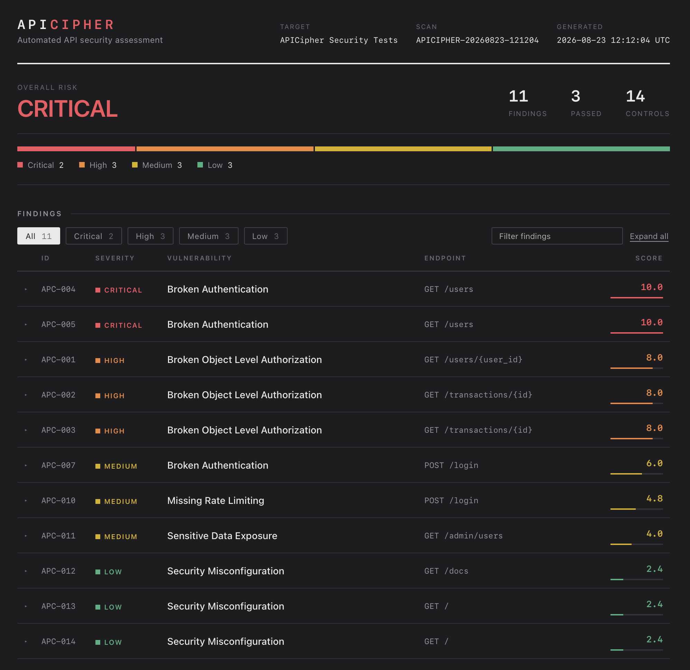

# APICipher

An automated API security scanner. It runs a set of attacks against a target API,
scores whatever it finds by how dangerous the issue actually is, and writes out a
report and a dashboard.

I built it because most API security testing I'd seen was manual — send a request
in Postman, look at the response, decide if it's bad. That doesn't scale and it
isn't repeatable. I wanted the whole loop automated: test, score, report.

The project has two halves. The first is a deliberately vulnerable FastAPI app
that acts as the target. The second is the scanner that attacks it.

---



## What it looks for

| Vulnerability | OWASP API Top 10 |
| --- | --- |
| Broken Object Level Authorization (BOLA) | API1:2023 |
| Broken Authentication | API2:2023 |
| Sensitive Data Exposure | API3:2023 |
| Missing Rate Limiting | API4:2023 |
| Broken Function Level Authorization | API5:2023 |
| Security Misconfiguration | API8:2023 |

14 security controls in total.

## How it works

```
Target API  (FastAPI + SQLite + JWT)
     |
Postman collection  — 14 controls, run headless by Newman
     |
newman-results.json
     |
Risk engine  (Python)  — score and rank
     |
findings.json
     |
     +--> Markdown report
     +--> HTML dashboard
```

Every test asserts *secure* behaviour, so a failing test means a vulnerability was
found. That inversion is what makes it automatable — nothing needs to be eyeballed.

## Risk scoring

A flat list of 11 problems doesn't tell you what to fix first, so each finding gets
scored on three axes rated 1-5:

- **Likelihood** — how easily it can be exploited
- **Impact** — what happens if it is
- **Exposure** — who can reach the endpoint at all (5 = anyone, 4 = any logged-in
  user, 2 = admins only)

```
Risk Score = (Likelihood x Impact x Exposure) / 125 x 10
```

The axes are multiplied, not averaged, so something unreachable collapses toward
zero no matter how bad it would otherwise be.

Exposure is the axis that does the real work. Two of the findings are the same bug
— password hashes in a response body:

| ID | Reachable by | Score |
| --- | --- | --- |
| APC-004 | anyone, no login needed | 10.0 Critical |
| APC-011 | admins only | 4.0 Medium |

Same leak, very different urgency. A scanner that reports both as "password hash
exposure" isn't telling you anything useful.

Bands: Critical >= 9.0, High 7.0-8.9, Medium 4.0-6.9, Low < 4.0.

## Results

Scan against the vulnerable build:

| ID | Vulnerability | Endpoint | Severity | Score |
| --- | --- | --- | --- | --- |
| APC-004 | Broken Authentication | `GET /users` | CRITICAL | 10.0 |
| APC-005 | Broken Authentication | `GET /users` | CRITICAL | 10.0 |
| APC-001 | BOLA | `GET /users/{user_id}` | HIGH | 8.0 |
| APC-002 | BOLA | `GET /transactions/{id}` | HIGH | 8.0 |
| APC-003 | BOLA | `GET /transactions/{id}` | HIGH | 8.0 |
| APC-007 | Broken Authentication | `POST /login` | MEDIUM | 6.0 |
| APC-010 | Missing Rate Limiting | `POST /login` | MEDIUM | 4.8 |
| APC-011 | Sensitive Data Exposure | `GET /admin/users` | MEDIUM | 4.0 |
| APC-012 | Security Misconfiguration | `GET /docs` | LOW | 2.4 |
| APC-013 | Security Misconfiguration | `GET /` | LOW | 2.4 |
| APC-014 | Security Misconfiguration | `GET /` | LOW | 2.4 |

The worst one is APC-004: `GET /users` had no authentication dependency at all and
returned raw ORM objects, so anyone could pull every user's email and argon2 hash
without an account.

Three controls pass even in vulnerable mode (malformed JWTs are rejected, and the
admin role check works). I kept those deliberately — if every test failed, that
would suggest the tests were broken rather than the API.

## Before and after

Every finding was then fixed, behind a `SECURE_MODE` flag so the vulnerable
version still exists to demo against.

```
SECURE_MODE=false    CRITICAL    11 findings     3/14 controls passed
SECURE_MODE=true     NONE         0 findings    14/14 controls passed
```

Same code, same endpoints, same tests. One environment variable.

I used a flag instead of two branches because branches drift — fix a typo on one
and forget the other, and the comparison stops meaning anything. With a flag you
can re-run both and prove the fix rather than claim it.

To be clear, this pattern is fine for a lab and a terrible idea in production. You
would never ship an API with a switch that turns off its authorization checks.

## Running it

Requires Python 3.11+ and Node (for Newman).

```bash
python3 -m venv venv
source venv/bin/activate
pip install -r requirements.txt
npm install
```

Create a `.env`:

```
SECRET_KEY=your-secret-here
SECURE_MODE=false
```

Start the target API:

```bash
uvicorn api.main:app --reload
```

Register the three test accounts (`apc_user_a`, `apc_user_b`, `apc_admin`) via
`POST /register`, then promote the admin:

```bash
sqlite3 apicipher.db "UPDATE users SET role='admin' WHERE username='apc_admin';"
```

Then run the whole pipeline:

```bash
npx newman run postman/APICipher-Security-Tests.json \
  -e postman/APICipher-Local.postman_environment.json \
  --reporters cli,json --reporter-json-export reports/newman-results.json \
&& python -m scanner.scanner \
&& python -m scanner.report_generator \
&& python -m dashboard.app
```

Open `dashboard/index.html` to see the results.

Tests:

```bash
python -m unittest discover -s tests
```

## Layout

```
api/          target API — routes, models, auth, and the SECURE_MODE fixes
scanner/      risk engine, vulnerability rules, report generator
postman/      the security test collection
dashboard/    generates a self-contained HTML dashboard
reports/      scan output
tests/        unit tests for the scoring logic
```

The dashboard is a static HTML generator rather than a Streamlit or Flask app. No
extra dependencies, it opens offline, and it commits to the repo.

## Things that went wrong

**My first risk model was miscalibrated.** It scored BOLA at 6.4 (Medium) and a
missing token-expiry claim at 10.0 (Critical), which is backwards — BOLA is OWASP's
number one and I had a screenshot of it leaking another user's salary. The problem
was that every finding in a class inherited the same likelihood, so three very
different Broken Authentication issues all pinned at 10.0. I split likelihood into
a per-class default with per-finding overrides. Missing expiry needs a stolen token
first; anonymous data exposure needs nothing. That precondition is the difference
and the model wasn't capturing it.

**I broke my own lab while fixing it.** When I added Pydantic response models to
stop the password hashes leaking, I applied them unconditionally instead of putting
them behind `SECURE_MODE`. Two vulnerabilities silently disappeared from the
vulnerable build and the scan dropped from 11 findings to 9. The scanner caught it,
which was a decent sign the thing works.

**The evidence was leaking the thing it was reporting.** The first version of the
report quoted full argon2 hashes from real accounts straight into a Markdown file
that would have gone into git. Reporting a credential leak by republishing the
credentials is not great. Evidence is now redacted to `$argon2id$[REDACTED]`, which
still proves a `password` field is exposed without handing it over.

**Postman fought me.** The desktop app threw render errors, "failed to duplicate
request", and it turns out exporting *run results* is now behind a paid plan. That
last one pushed me to Newman earlier than planned, which was the right call anyway —
a scan you can run from the terminal is scriptable and can go in CI. A GUI you have
to click through can't.

**Smaller ones:** an indentation error that put `Transaction` inside `User`, and a
long debugging session on a 401 that turned out to be my own rate limiter working
correctly after the brute-force test locked the account out.

## Limitations

The Postman collection is written against this specific API — its endpoints, its
user IDs, its test accounts. You can't point this at some other API and get results
without rewriting the collection by hand. It's an assessment of one API, not a
general-purpose tool yet.

The rate limiter stores counters in memory, so they reset when the process
restarts. Real deployments would need Redis so the limit survives restarts and is
shared between workers.

## Next

The obvious next step is generating the tests from an OpenAPI spec instead of
hand-writing them — discover the endpoints, find the ones with path parameters, and
generate the BOLA tests automatically. That's what would turn this from a one-off
assessment into something anyone could run against their own API.

After that: config-driven targets, a non-zero exit code when a Critical is found so
it can block a CI build, and diffing scans to show what changed since last time
(the finding IDs are already stable, so most of that is done).
